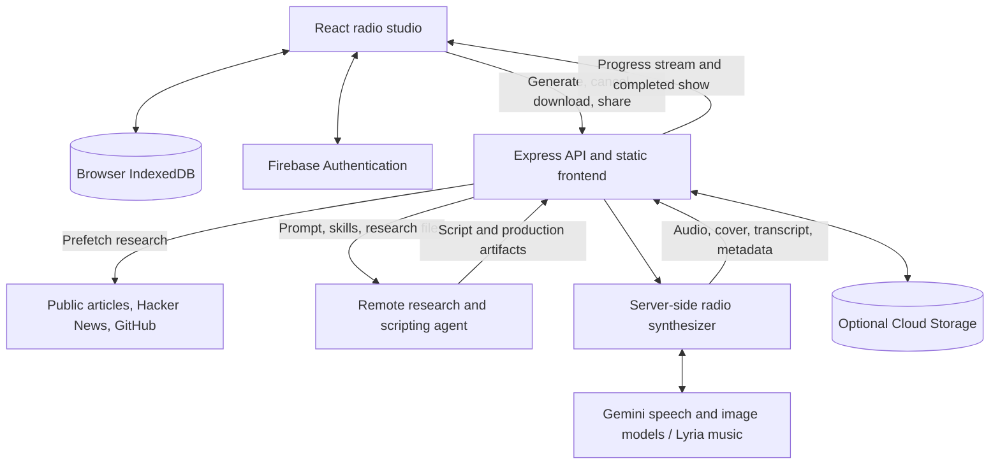

# Lesson Podcast Generator

Turn a topic, article URL, GitHub repository, or Hacker News story into a radio show with a host, callers, background music, cover art, and a synchronized transcript.

## Deployment

The app runs as a Node.js service. Express serves both the API and the built React frontend.

### 1. Prepare the runtime

- Use Node.js 22.12 or later with npm.
- Provide a Gemini API key with access to the agent and media models referenced in `server/lib/agentClient.ts` and `server/lib/radioSynthesizer.ts`. These include preview models; confirm access before deploying.
- Install FFmpeg on the host for MP3 encoding and music mixing. The synthesizer falls back to WAV when FFmpeg is unavailable.
- Allow outbound HTTPS for Gemini, research sources, and any configured Google Cloud services.

Python research and staging scripts run in the remote agent environment. They do not need to run on the Node.js host.

### 2. Configure the environment

Set these variables through your hosting platform's environment or secret settings:

| Variable | Purpose |
| --- | --- |
| `NODE_ENV` | Set to `production` to serve the built frontend and enable production quota enforcement. |
| `GEMINI_API_KEY` | Required for show generation; used only by the server. |
| `GCS_BUCKET_NAME` | Optional Google Cloud Storage bucket for shared episodes. Sharing requires this setting. |
| `DAILY_QUOTA_LIMIT` | Daily generation allowance per identified user or caller; defaults to `3` in production. |
| `GOOGLE_APPLICATION_CREDENTIALS` | Path to an external credentials file when using Google Application Default Credentials outside a managed identity environment. |

For your own deployment, replace `firebase-applet-config.json` with your Firebase web app configuration. Configure Google sign-in and authorize your deployed domain in Firebase Authentication. The server must resolve the matching Firebase project to verify sign-in tokens.

If enabling shared episodes, provision a Cloud Storage bucket and give the server identity permission to read and write its episode objects. Cloud Storage uses Application Default Credentials.

### 3. Install and build

From the project root:

```bash
npm ci
npm run lint
npm run build
```

The build produces the frontend in `dist/` and the server bundle at `dist/server.cjs`.

Keep these files and directories in the runtime deployment:

- `dist/`
- `agent/` — loaded from disk and sent to the remote agent
- `public/` — includes default show notes
- `firebase-applet-config.json`
- `package.json`, `package-lock.json`, and installed production dependencies

Run the service from the project root so these relative paths resolve correctly. The host also needs writable temporary storage for media processing, downloads, and the quota cache.

### 4. Start the service

With `GEMINI_API_KEY` supplied by the host environment:

```bash
NODE_ENV=production npm start
```

The current server binds to `0.0.0.0:3000`. It tries the next port if 3000 is occupied; it does not currently read a `PORT` environment variable. Configure the host or reverse proxy to route to port 3000 and keep that port available.

Configure HTTPS and allow long-running streaming responses through the proxy. Show generation streams progress over the generation request, so proxy buffering and short request timeouts can interrupt it. The server currently sets Express `trust proxy` to `2`; review that setting against your deployment's proxy chain.

### 5. Verify the deployment

```bash
curl --fail http://localhost:3000/api/health
```

Expected response:

```json
{"status":"ok"}
```

Then open the app and generate an episode to verify agent access, media generation, and playback. The health endpoint checks that the server responds; it does not validate external services.

Start with one server instance. Active generations and ownership records are held in process memory, and production quotas are stored in `/tmp/ai_radio_quota_cache.json`. These are not shared across replicas and do not provide durable quota enforcement across host replacement. Shared state would be needed for reliable horizontal scaling.

## System architecture



### Generation flow

1. **Request:** The React studio sends the topic and show options to `POST /api/generate-show`.
2. **Research:** The server prefetches supported sources with public-address checks, then supplies the prompt, research, and files from `agent/` to the remote agent.
3. **Script and staging:** The agent researches the topic, writes dialogue, and runs Python skills to stage speech, music, mixing, metadata, and cover plans.
4. **Media production:** The Node.js synthesizer calls the media models, generates speaker audio, applies telephone effects, mixes music, and prepares cover art and transcript timing. API credentials stay on the server.
5. **Playback and storage:** The browser receives the completed show and saves the user's library in IndexedDB. Optional sharing stores episode assets and metadata in Cloud Storage through the server.

### Main components

| Location | Responsibility |
| --- | --- |
| `src/App.tsx` | Studio interface, generation progress, authentication, playback, downloads, and sharing. |
| `src/components/Transcript.tsx` | Transcript highlighting and seek controls. |
| `src/lib/clientDb.ts` | Browser-local episode persistence. |
| `src/data.ts`, `src/types.ts` | Show data conversion, sample content, and shared frontend types. |
| `server.ts` | Express routes, streaming orchestration, quotas, cancellation, downloads, and sharing. |
| `server/lib/agentClient.ts` | Remote agent interaction creation and event streaming. |
| `server/lib/urlPrefetch.ts` | Public URL validation and research prefetching. |
| `server/lib/jsonExtractor.ts` | Structured artifact extraction from agent responses. |
| `server/lib/radioSynthesizer.ts` | Speech generation, audio processing, music, cover art, and final show assembly. |
| `agent/` | Agent configuration, workflow instructions, and Python production skills. |
| `public/shows/` | Bundled episode metadata. |

## Local development

Install dependencies:

```bash
npm ci
```

Create a local `.env.local` file:

```dotenv
GEMINI_API_KEY=your_api_key_here
```

The application does not automatically load this file. Start the development server with Node's explicit environment-file support:

```bash
node --env-file=.env.local --import tsx server.ts
```

Alternatively, supply `GEMINI_API_KEY` in your shell environment and run `npm run dev`. Open `http://localhost:3000`.

## Commands

| Command | Purpose |
| --- | --- |
| `npm run dev` | Start Express with Vite development middleware. |
| `npm run lint` | Run TypeScript checking without emitting files. |
| `npm run build` | Build the frontend and bundle the server. |
| `npm start` | Run the compiled server; set `NODE_ENV=production` for deployment. |
| `npm run preview` | Preview the Vite frontend build only; does not start the application API. |
| `npm run clean` | Remove the build output. |
